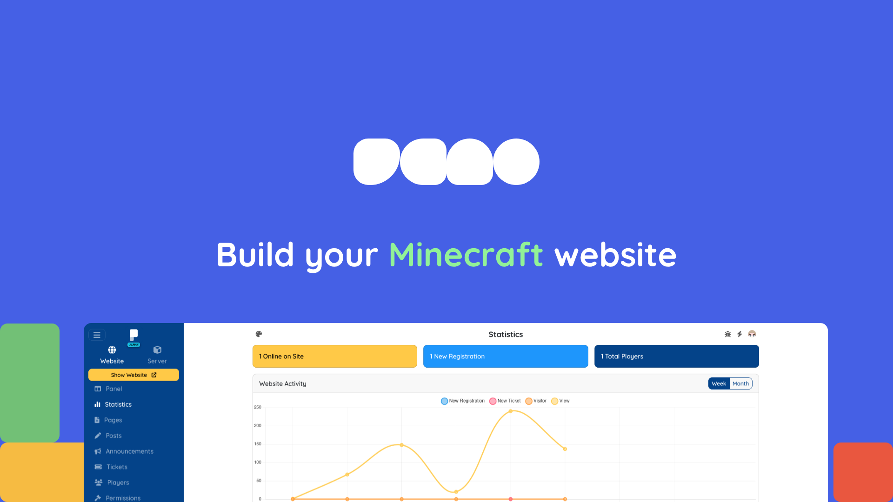
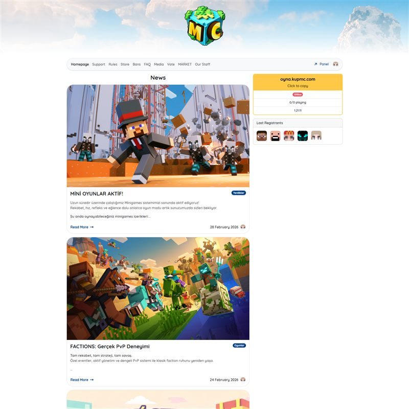
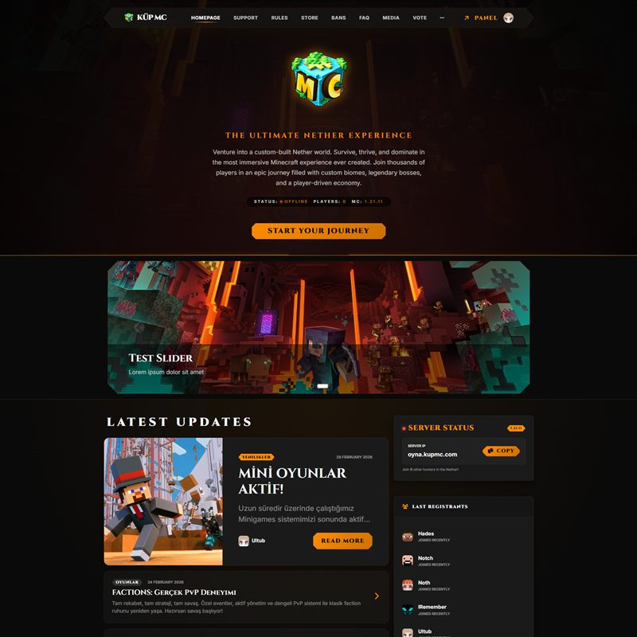
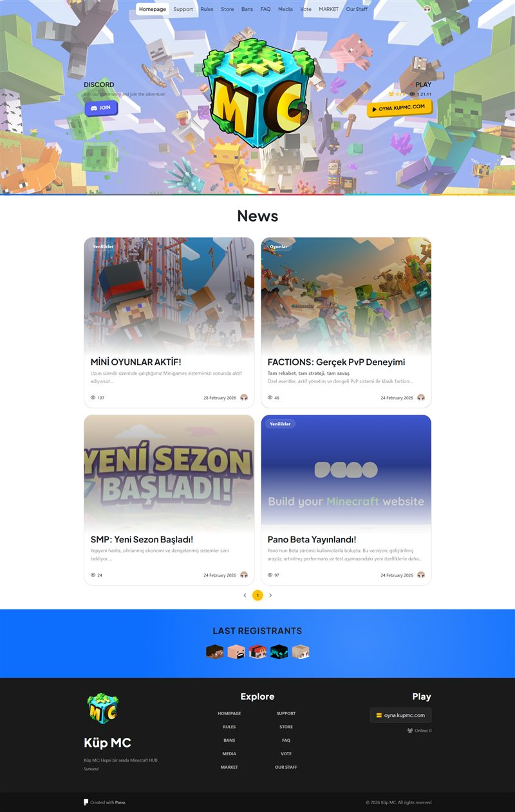
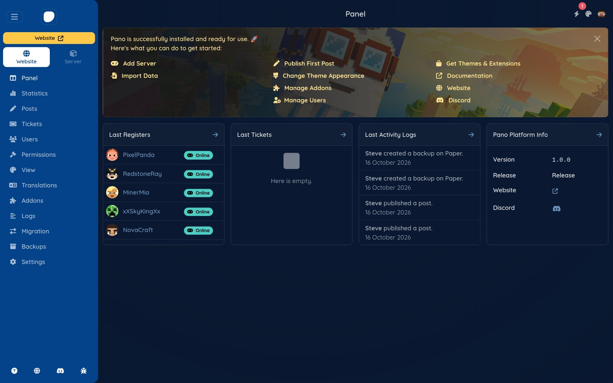
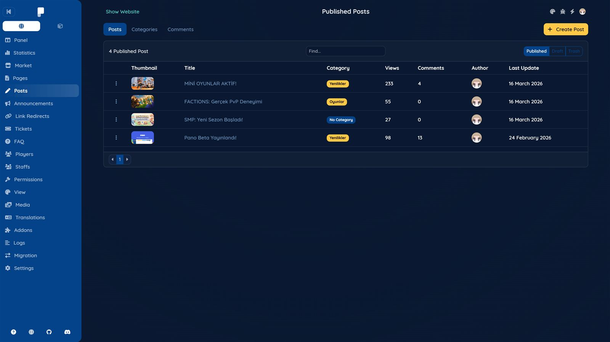
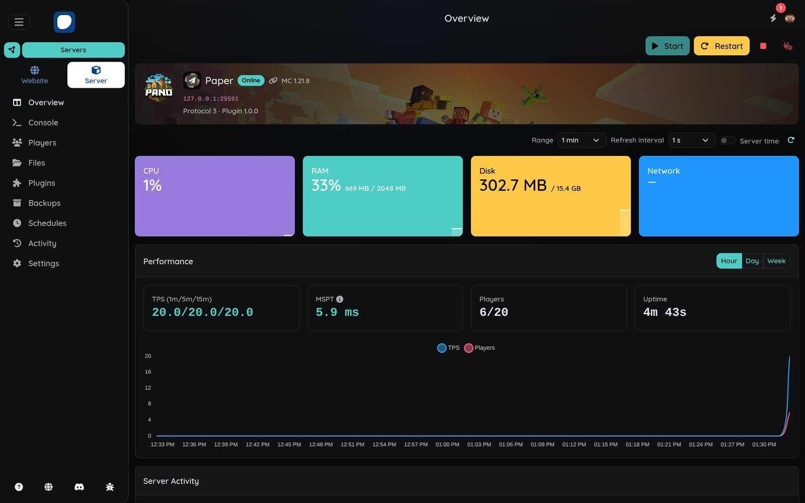

<p align="center">
  
</p>

<h1 align="center">Pano</h1>

<h3 align="center">The website your Minecraft server deserves.</h3>

<p align="center">
  News, store, support, players, staff and your servers, all in one place.<br>
  Free, open source, and running on your own machine in a few minutes.
</p>

<p align="center">
  <a href="https://panomc.com/downloads"><b>Download</b></a> ·
  <a href="https://demo.panomc.com"><b>Live demo</b></a> ·
  <a href="https://panomc.com/docs"><b>Docs</b></a> ·
  <a href="https://panomc.com/discord"><b>Discord</b></a>
</p>

<p align="center">
  <a href="https://github.com/PanoMC/pano/releases/latest"></a>
  <a href="https://github.com/PanoMC/pano/stargazers"></a>
  <a href="https://panomc.com/discord"></a>
  <a href="LICENSE"></a>
</p>

<p align="center">
  
</p>

---

## ✨ Why Pano?

Running a Minecraft server is already a full-time hobby. Building a website for it shouldn't be another one.

Pano gives your community a real home on the web: a beautiful site for your players and a friendly panel for you.
No coding, no hosting puzzles, no five different plugins glued together.

<table>
  <tr>
    <td width="33%" valign="top">
      <h3>🚀 Ready in minutes</h3>
      One command installs everything. A setup wizard walks you through the rest. No database knowledge needed.
    </td>
    <td width="33%" valign="top">
      <h3>🎨 Looks great out of the box</h3>
      Pick a theme, add your logo and colors, and your site already feels like <i>your</i> server.
    </td>
    <td width="33%" valign="top">
      <h3>🎮 Connected to your game</h3>
      Players, online status and staff come straight from your Minecraft server, live.
    </td>
  </tr>
  <tr>
    <td width="33%" valign="top">
      <h3>🧩 Grows with you</h3>
      Add a store, voting, bans, FAQ and more from the addon market with a single click.
    </td>
    <td width="33%" valign="top">
      <h3>🌍 Speaks your language</h3>
      Fully translatable. Your players read your site in their own language.
    </td>
    <td width="33%" valign="top">
      <h3>💙 Free & open source</h3>
      Yours to keep, yours to change. No monthly fee, no lock-in.
    </td>
  </tr>
</table>

---

## 🖼️ Your server, your style

Every Pano site starts with a theme. Switch between them any time, your content stays.

<table>
  <tr>
    <td align="center" width="33%">
      <br>
      <b>Vanilla</b><br><sub>Clean and bright</sub>
    </td>
    <td align="center" width="33%">
      <br>
      <b>Blaze</b><br><sub>Dark and fiery</sub>
    </td>
    <td align="center" width="33%">
      <br>
      <b>Blocky</b><br><sub>Playful and colorful</sub>
    </td>
  </tr>
</table>

<p align="center">More themes are waiting in the <a href="https://panomc.com">Pano market</a>.</p>

---

## 🛠️ A panel you'll actually enjoy

Everything you need to run your community, without digging through config files.

<p align="center">
  
</p>

- 📰 **News & pages** — write posts with a rich editor, add images, organize them in categories.
- 🎫 **Support tickets** — players ask, your staff answers, all on your site.
- 👥 **Players & staff** — see who joined, who's online, and give your team the right permissions.
- 📊 **Statistics** — watch visits, sign-ups and activity grow.
- 🧩 **Addons & themes** — install, update and manage them from the panel.
- 💾 **Backups & migration** — keep your data safe, or bring it over from your old website.

<p align="center">
  
</p>

---

## 🎮 Your servers, right inside the panel

Pano isn't only a website. Start, stop and watch your Minecraft servers from the same place.

<p align="center">
  
</p>

- 🖥️ **Live console** — send commands and read logs from your browser.
- 📈 **Performance at a glance** — CPU, RAM, disk, TPS and player count, updated live.
- 📁 **Files, plugins & schedules** — edit files, manage plugins and plan restarts without FTP.
- 💾 **Server backups** — one click before that risky update.

Works with **Paper, Spigot, Folia, BungeeCord, Velocity and Fabric** through the
[Pano Minecraft plugin](https://github.com/PanoMC/pano-mc-plugin).

---

## ⚡ Get started

**macOS / Linux**

```bash
curl -fsSL https://panomc.com/install | bash
```

**Windows** (PowerShell)

```powershell
irm https://panomc.com/install.ps1 | iex
```

That's it. Open the address it shows you and the setup wizard takes it from there. 🎉

Prefer Docker or a plain download? Every option is on [panomc.com/downloads](https://panomc.com/downloads).

---

## 💬 Join the community

Questions, ideas, or just want to show off your server? Come say hi.

<p align="center">
  <a href="https://panomc.com/discord"></a>
</p>

If Pano helps your server, a ⭐ on this repo means a lot to us.

---

<details>
<summary><b>👩‍💻 For developers</b></summary>

<br>

This is the core platform (Kotlin + Vert.x). The interfaces and the in-game plugin live in their own repositories:

- [**panel-ui**](https://github.com/PanoMC/panel-ui) — the management panel
- [**setup-ui**](https://github.com/PanoMC/setup-ui) — the setup wizard
- [**vanilla-theme**](https://github.com/PanoMC/vanilla-theme) — the default theme
- [**pano-mc-plugin**](https://github.com/PanoMC/pano-mc-plugin) — the Minecraft plugin
- [**docs**](https://github.com/PanoMC/docs) — the documentation

**Release channels:** `alpha` (early, experimental), `beta` (feature-complete, may have minor bugs), release (stable).

**Requirements:** JDK 17+ to run Gradle (the jar itself runs on Java 11+), MariaDB 10.5+ / MySQL 8.0+.
Docker is optional.

```bash
git clone --recursive https://github.com/PanoMC/pano.git
cd pano
./gradlew downloadUIReleases   # once
./gradlew run
```

Run a release jar with `java -jar Pano-<version>.jar` (add `-nogui` for headless).

Everyone is welcome to open issues. Irrelevant or abusive issues may be closed.

</details>

---

<p align="center">
  Made with 💙 for Minecraft communities · Licensed under <a href="LICENSE">GPLv3</a>
</p>
